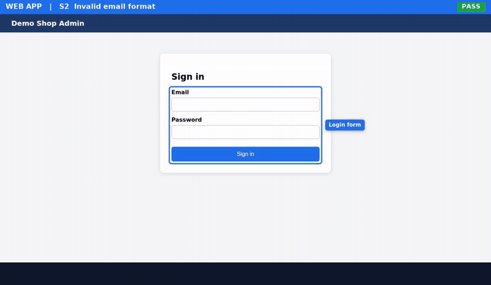
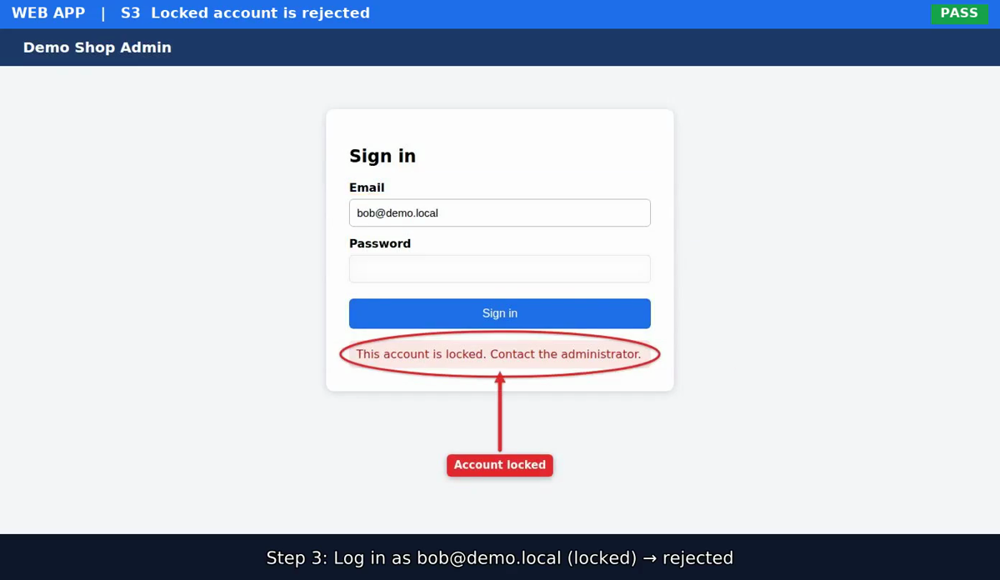
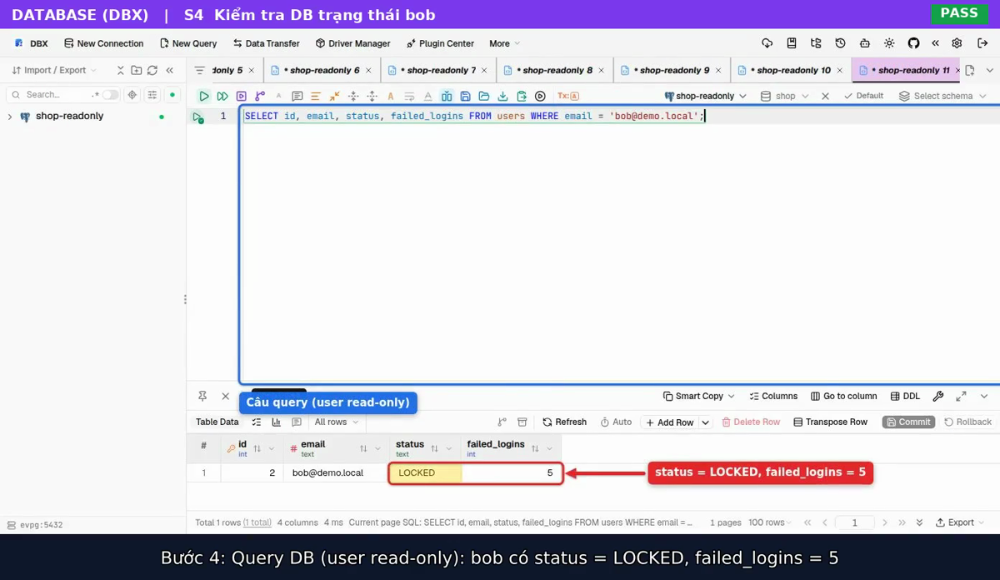
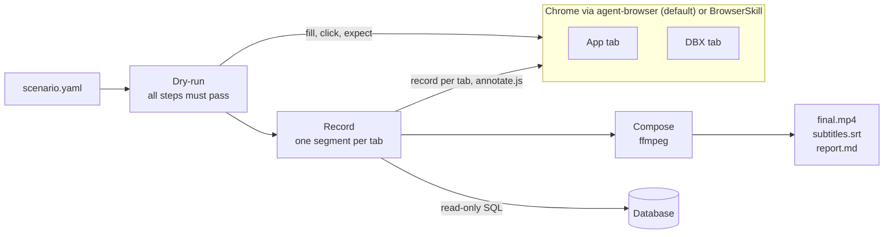

<div align="center">

# TIRAI

### Test evidence your AI agent records for you.

Describe a test scenario. Your agent runs it in a real browser or desktop app, checks the database in a second tab,<br>
draws arrows and boxes on screen, and hands you **one subtitled MP4, HTML/Excel/JUnit reports and a signed manifest**.

[](https://github.com/2tsoftwareapp/TIRAI/actions/workflows/ci.yml)
[](pyproject.toml)
[](docs/getting-started.md)
[](LICENSE)

[Quick prompt](#quick-prompt) · [Quick start](#quick-start) · [How it works](#how-it-works) · [Scenario format](docs/scenario-format.md) · [Agents](docs/agents.md) · [Docs](#documentation)

<br>



<sub>Real output of <code>tirai record examples/demo/login-lock.yaml</code>: web app tab, DBX tab, annotations, PASS badges and burned-in subtitles.</sub>

</div>

---

## Why TIRAI

QA evidence is usually a pile of screenshots, a screen recording with dead air, and a spreadsheet stitched together by hand.
TIRAI turns it into a repeatable artifact:

- **Scenario first.** Every step states what to do and what must be true. The video is a by-product of a passing test, not a substitute for one.
- **Dry-run before record.** Steps are executed once without recording, so the final video never shows failed attempts or agent "thinking" pauses.
- **UI and database in one story.** The app and [DBX web](https://github.com/t8y2/dbx) run in browser tabs; TIRAI records each tab and cuts them back into scenario order.
- **Annotations like Snagit.** Boxes, circles, arrows, labels, highlights and blur are drawn inside the page and follow the real element positions.
- **Web and desktop.** Browser tabs run on agent-browser or BrowserSkill; native apps (`app:` tabs) run on [agent-desktop](https://github.com/vercel-labs/agent-desktop) through the accessibility tree.
- **Watchable video.** Camera follow (zoom and pan between targets), fast-forwarded waits, chapters, multilingual subtitles and optional voice-over.
- **Evidence you can hand over.** PII masking plus an OCR pass over the final video, `manifest.sha256` with SSH signature and RFC 3161 timestamp, JUnit/Xray/TestRail files, and one HTML index across runs.
- **Built for agents.** Ships as a skill for Claude Code, Codex, Antigravity, Cursor and Devin. Every command also works by hand.

<table>
<tr>
<td width="50%"></td>
<td width="50%"></td>
</tr>
<tr>
<td align="center"><sub><b>Web app</b>: circle + arrow on the error, password blurred</sub></td>
<td align="center"><sub><b>Database (DBX)</b>: read-only query, matching cells boxed</sub></td>
</tr>
</table>

## Quick prompt

Paste this into Claude Code, Codex, Cursor, Antigravity or Devin and let the agent set everything up:

```text
Install TIRAI (test evidence recorder) on this machine and make sure it is ready to record.
Read https://raw.githubusercontent.com/2tsoftwareapp/TIRAI/main/llms.txt first and follow it:
1. Install with the official installer for this OS (install.sh on macOS/Linux, install.ps1 on Windows),
   passing --yes and --agent for the agent you are running in.
2. Start DBX web with `tirai dbx -d` if I want database checks.
3. Run `tirai doctor` and fix every failing required check. Ask me before using sudo.
4. Show me the doctor output and tell me how to record my first scenario.
```

Then describe what to prove:

```text
Use the tirai-evidence skill to record evidence for <feature> on <URL>:
step 1 <action> → expect <result>; step 2 check <table/condition> in the database → expect <rows>.
Write the scenario, dry-run until every step passes, then record and give me final.mp4 and report.md.
```

> [!TIP]
> [`llms.txt`](llms.txt) is a short index for LLMs; [`llms-full.txt`](llms-full.txt) inlines every doc,
> the skill, the CLI help and the demo scenario in one file, handy for agents without web access.

## Quick start

**1. Install** — no Python needed: the installer uses the prebuilt binary for your OS, or builds from source (with a private Python in `~/.tirai` if yours is missing or older than 3.10). Then `tirai setup` installs ffmpeg (a current static build if yours is missing or older than 6.0), the agent-browser driver with Chrome for Testing, DBX web, the BrowserSkill CLI and the agent skills.

```bash
# macOS / Linux
curl -fsSL https://raw.githubusercontent.com/2tsoftwareapp/TIRAI/main/install.sh | sh
```

```powershell
# Windows (PowerShell)
irm https://raw.githubusercontent.com/2tsoftwareapp/TIRAI/main/install.ps1 | iex
```

**2. Check** — no browser extension needed with the default driver:

```bash
tirai doctor     # every required check should be "ok"
tirai dbx -d     # start DBX web on http://127.0.0.1:4224 (binary from setup, or Docker on macOS)
```

To drive your own logged-in browser instead, install the [BrowserSkill](https://github.com/Tencent/BrowserSkill) extension and set `driver: bsk` (or `--driver bsk`).

**3. Record** — ask your agent, or run it yourself:

> *"Record evidence for login validation: invalid email, locked user, and check the user's status in the database."*

```bash
tirai init scenarios/login.yaml         # scenario template
tirai run scenarios/login.yaml --dry-run
tirai record scenarios/login.yaml       # → evidence/record/final.mp4
```

Want to see it end to end first? The [demo](docs/getting-started.md) starts a web app, PostgreSQL and DBX with one `docker compose up`.

<details>
<summary><b>Other install options</b></summary>

| Option | Command |
|---|---|
| Non-interactive | `curl -fsSL .../install.sh \| sh -s -- --yes --agent claude` |
| Windows non-interactive | `$env:TIRAI_SETUP_ARGS="--yes --agent claude"; irm .../install.ps1 \| iex` |
| Prebuilt binary only | `curl -fsSL .../install.sh \| sh -s -- --binary` (PowerShell: `$env:TIRAI_INSTALL_MODE="binary"`) |
| Build from source | `curl -fsSL .../install.sh \| sh -s -- --source` · local checkout: `TIRAI_SOURCE=. sh install.sh --source` |
| Your own binary | `python scripts/build_binary.py` then `TIRAI_BINARY=dist/tirai-<os>-<arch> sh install.sh --binary` |
| Claude Code plugin | `/plugin marketplace add 2tsoftwareapp/TIRAI` then `/plugin install tirai-evidence@tirai` |
| Preview only | `tirai setup --dry-run` |

`tirai setup` uses the native package manager: Homebrew on macOS; apt, dnf, pacman, zypper or apk on Linux; winget, Chocolatey or Scoop on Windows.
Every path and tool can be overridden — see [configuration](docs/configuration.md).

</details>

## How it works



TIRAI is the orchestration layer. It does not reinvent browser automation or a database UI:

| Layer | Provided by |
|---|---|
| Desktop apps (accessibility tree), screen recording with ffmpeg | [agent-desktop](https://github.com/vercel-labs/agent-desktop) (`app:` tabs; Linux needs X11 + AT-SPI) |
| Browser control, screenshots, tab recording | [agent-browser](https://github.com/vercel-labs/agent-browser) (default, headless or `--headed`) or [Tencent BrowserSkill](https://github.com/Tencent/BrowserSkill) (`bsk`, your real browser) |
| Database UI in the browser (100+ engines) | [DBX web](https://github.com/t8y2/dbx) |
| Scenario runner, DOM and DB assertions, annotation overlay, timeline, video composition, report | **TIRAI** (Python, ffmpeg, `annotate.js`) |

Details: [architecture](docs/architecture.md).

## A scenario step

```yaml
- id: S3
  tab: app
  title: Locked account is rejected
  subtitle: "Step 3: log in as bob@demo.local (locked) → rejected"
  actions:
    - fill:  { selector: "#email",    value: "bob@demo.local" }
    - fill:  { selector: "#password", value: "${APP_PASSWORD}" }   # secrets come from env / .env
    - click: "button[type=submit]"
  expect:
    - text_contains: { selector: ".error", text: "This account is locked" }
  annotate:
    - circle: { target: ".error" }
    - arrow:  { target: ".error", from: bottom, label: "Account locked" }
    - blur:   { target: "#password" }

- id: S4
  tab: db
  title: Database shows bob as LOCKED
  actions:
    - sql: "SELECT id, email, status, failed_logins FROM users WHERE email = 'bob@demo.local';"
  expect:
    - db:                                  # independent read-only check, not pixels
        sql: "SELECT status, failed_logins FROM users WHERE email = 'bob@demo.local'"
        rows: [{ status: LOCKED, failed_logins: 5 }]
  annotate:
    - box:   { target: { grid: { column: status, toColumn: failed_logins, row: 1 } } }
    - arrow: { target: { grid: { column: status, toColumn: failed_logins, row: 1 } }, from: right, label: "LOCKED, 5 failed logins" }
```

Full vocabulary: [scenario format](docs/scenario-format.md) · [annotations](docs/annotations.md).

## What you get

```text
evidence/record/
├── final.mp4             title card + every step (chapters), PASS/FAIL header, burned-in subtitles
├── subtitles.srt         one cue per step, aligned to the final video (+ subtitles.<lang>.srt)
├── report.md             step table: tab, title, status, video time, checks
├── report.html           self-contained: video player, click a step to jump, embedded screenshots
├── report.xlsx           evidence sheet: expected / actual / status / screenshot per step
├── manifest.sha256       SHA-256 of every evidence file; `tirai verify` detects edits (+ .sig/.pub/.tsr after `tirai sign`)
├── junit.xml             one testcase per step (CI test reports); `tirai export` adds xray.json, testrail.csv
├── step-S1.png …         one screenshot per step
├── seg-01-app.mp4 …      raw per-tab recordings
└── timeline.final.json   machine-readable timeline (no secrets)
```

## Works with your agent

| Agent | Install | Notes |
|---|---|---|
| Claude Code | `tirai setup` or plugin marketplace | skill + BrowserSkill skill |
| Codex | `tirai setup --agent codex` | skill + BrowserSkill skill |
| Cursor | `tirai setup --agent cursor` | skill + BrowserSkill skill |
| Antigravity | `tirai setup --agent antigravity` | skill |
| Devin | `tirai install-skill --agent devin --project <repo>` | per-repository skill |

Anything else: `tirai install-skill --dest <dir>`. See [agents](docs/agents.md).

## CLI

| Command | Purpose |
|---|---|
| `tirai setup` | Install ffmpeg (version-checked), agent-browser, DBX web, BrowserSkill CLI and agent skills; opt-in: `--only ocr voice agent-desktop` |
| `tirai dbx [-d] [--port]` | Start DBX web (installed binary, or Docker) |
| `tirai doctor` | Check tools, fonts, drivers and the browser connection |
| `tirai init <file>` | Write a scenario template |
| `tirai validate <file>` | Check structure, required environment variables, steps that write data and read-only DSNs |
| `tirai run <file> --dry-run \| --record` | Execute steps, optionally recording; a dry-run stops before `writes:` steps unless `--allow-writes` (`--until`, `--keep-session` + `--from-step`, `--fresh`) |
| `tirai record <file>` | Dry-run, record and compose in one go (`--record-failures`: keep going and record bug evidence) |
| `tirai verify [dir]` | Check an evidence folder against its `manifest.sha256` |
| `tirai compose <timeline.json>` | Rebuild the video and report from a recorded timeline |
| `tirai inspect <file\|url>` | List every step's page elements with unique locators and write a ready `targets:` block (use as `@name`) |
| `tirai capture <url>` | Click a flow once in the browser; get a scenario (`from-trace` converts a bsk trace) |
| `tirai dbx-connect` | Create/update the DBX connection from a DSN (`--dsn-env EV_DB_DSN --name shop`) |
| `tirai mcp` | Run the MCP server (validate, dry_run, record, compose, verify, sign, export, scan_pii, index, from_spec, capture, inspect, …) |
| `tirai install-skill` | Install the skill for an agent or into any directory |
| `tirai from-spec <file>` | Draft a scenario from Gherkin `.feature`, a Markdown table or CSV (`--url` resolves selectors live) |
| `tirai export <dir>` | Write `junit.xml`, `xray.json` (Xray import) and `testrail.csv` (TestRail import); nothing is uploaded |
| `tirai sign <dir> --key <ssh key> [--tsa]` | Sign `manifest.sha256` (`ssh-keygen -Y`), optional RFC 3161 timestamp; `verify --pubkey` checks it |
| `tirai scan-pii <dir> [--fix]` | OCR the final video for PII (incl. canvas text) and optionally pixelate hits |
| `tirai index <dirs…> -o index.html` | One filterable HTML page for many evidence runs |
| `tirai compose … --voice` | Add spoken subtitles (say / SAPI / espeak-ng / custom) |

## Security

- **Secrets** are referenced as `${ENV_VAR}` (shell or a git-ignored `.env`) and never written to timelines, reports or video metadata.
- **Database access is read-only**: use a read-only user for both DBX and `expect: db`; `tirai validate` warns when a DSN can write.
- **Shared test data**: steps marked `writes:` don't run in a dry-run unless `--allow-writes`; `cleanup:` undoes them and the report lists what was written.
- **`tirai init`** adds `**/.env` and `evidence/` to `.gitignore`.
- **Blur is instant**: masks render before the next frame, so sensitive values never appear in the recording.
- **Automatic PII masking** (`privacy:`): emails, phones, cards, tokens and custom patterns are covered on every page; `privacy.ocr` / `tirai scan-pii` OCR the final video to catch text drawn on canvas (DBX grids, desktop apps).
- **Tamper evidence**: `tirai sign` signs `manifest.sha256` with an SSH key (optional RFC 3161 timestamp); `tirai verify --pubkey` rejects edited files, regenerated manifests and the wrong key.
- **Downloads are pinned**: `tirai setup` checks SHA-256 for agent-browser, agent-desktop, DBX web and ffmpeg.
- **Browser profile**: agent-browser uses its own Chrome for Testing profile; BrowserSkill drives your real browser, so use a dedicated profile or Agent Window.

Report vulnerabilities via [SECURITY.md](SECURITY.md).

## Documentation

| | |
|---|---|
| [Getting started](docs/getting-started.md) | Install and run the demo end to end |
| [Scenario format](docs/scenario-format.md) | Tabs, actions, expectations, settings |
| [Annotations](docs/annotations.md) | Shapes, targets, animation modes |
| [Configuration](docs/configuration.md) | Environment variables, `.env`, DBX overrides |
| [Agents](docs/agents.md) | Skill locations per agent |
| [Architecture](docs/architecture.md) | Components and design rules |
| [Troubleshooting](docs/troubleshooting.md) | Common errors and fixes |
| [llms.txt](llms.txt) · [llms-full.txt](llms-full.txt) | Docs for LLMs: index and full single-file context |

## Contributing

Bug reports and pull requests are welcome. See [CONTRIBUTING.md](CONTRIBUTING.md) for setup, checks and the end-to-end demo, and [CHANGELOG.md](CHANGELOG.md) for release history.

The previous spec-to-test platform (TIRAI v1, TypeScript) is archived on branch [`archive/tirai-v1`](https://github.com/2tsoftwareapp/TIRAI/tree/archive/tirai-v1).

## License

[MIT](LICENSE)
